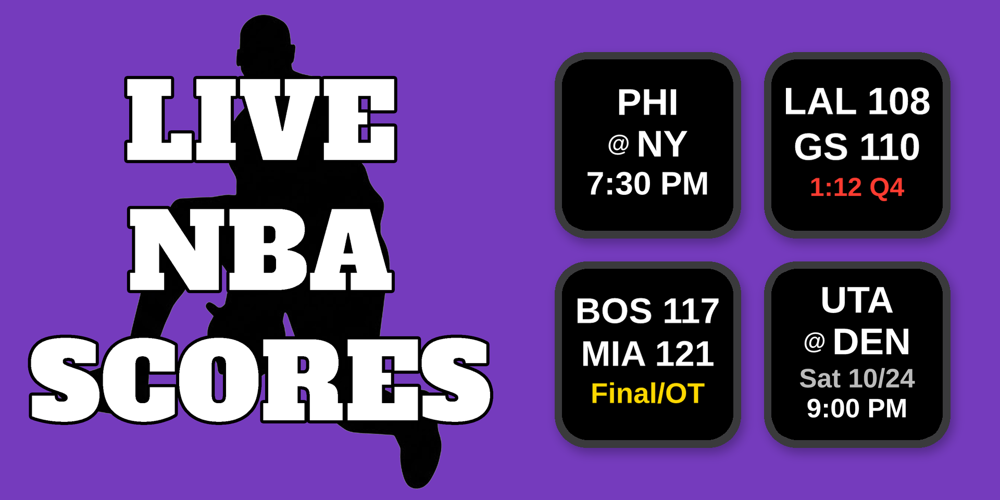
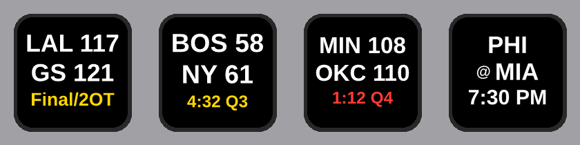
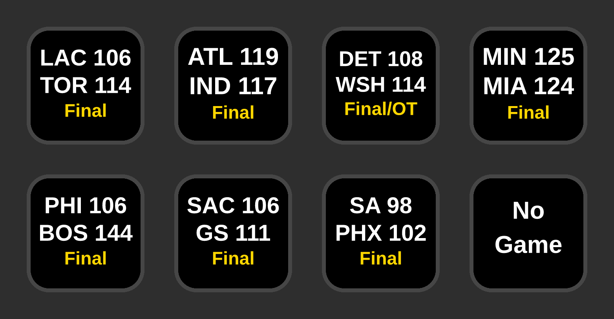

# Live NBA Scores — Stream Deck Plugin



A Stream Deck plugin that shows live basketball scores directly on your keys — **NBA, WNBA, and NBA G League**. Two actions: **Live NBA Scores** tracks one team per key, and **Live NBA Scoreboard** fills your keys with today's games for a league. Keys update automatically every 30 seconds.

  [](https://marketplace.elgato.com/product/live-nba-scores-8f051659-5306-4f5f-b1ff-c91aa8ecc0ea)

---

## Features

- **Three leagues** — NBA, WNBA, and G League, 76 teams total
- **Search by name or city** — type a team or location in the settings panel for instant results across all three leagues; searching an NBA team also surfaces its G League affiliate (e.g. "Pelicans" finds Laketown Squadron)
- **Browse by league** — pick a league, then a division (NBA) or conference (WNBA / G League), then a team
- **Live scores** — shows away score, home score, quarter, and game clock while a game is in progress, plus Halftime and End of Quarter
- **Crunch time** — the clock turns red in the last 2:00 of the 4th quarter and overtime, and the key refreshes every 15 seconds instead of 30
- **Lead-change and tie flash** — when the lead flips, the key blinks in the new leader's color and shows a short card with the margin (NY / UP 3); when the game gets tied, it blinks in the tying team's color and shows TIED / 88-88 (basketball scores change too often to flash on every basket)
- **End-of-game fireworks** — a short celebration in the winning team's colors when the game goes final
- **Pre-game** — shows the matchup (e.g. `BOS @ NY`) and tip-off time
- **Off days** — shows your team's next scheduled game (matchup, date, and time) instead of a dead-end "No Game"
- **Final scores** — "Final", "Final/OT", or "Final/2OT"
- **Gamecast shortcut** — press any key to open that game in ESPN Gamecast (the box score once the game is final)
- **Custom link** — optionally send key presses to a link of your choice (like a regional broadcast page) once the game has started
- **Custom background color** — set a per-key background color and opacity
- **No-flicker updates** — keys only redraw when the display actually changes
- **Multi-key support** — add as many team keys as you want; keys in the same league share one scoreboard request
- **Live NBA Scoreboard action** — a second action that lays out today's games for the NBA, WNBA or G League, one game per key, with lead-change flashes. Different boards can live on different pages (or share one, each with its own background color)

---

## Recent Updates

**v1.1.0.0**
- New: **Live NBA Scoreboard** action — drag it onto as many keys as you like and they fill with today's games, one game per key, in tip-off order. Pick the league for each board: **NBA** (up to 15 keys), **WNBA** (up to 7) or **G League** (up to 15)
- Same keys as the team action: lead-change and tie flashes with their cards (NY / UP 3, TIED / 88-88), the red crunch-time clock, and fireworks at the final
- Each board remembers its own settings, so an NBA page and a G League page work, and boards with different settings can share a page; give each board its own background color to tell them apart
- Fill top-to-bottom or left-to-right, and optionally send finished games to the end (recommended on smaller Stream Decks). More games than keys: the last key shows "+N more"; extra keys show "No Game". Both open ESPN's scoreboard for that league
- The board moves to the next day at 2:00 AM, same as the team keys. On a day with no games, it shows the next game day's schedule with the day on each key
- Final games now open ESPN's box score instead of Gamecast, on both actions
- Neutral-site games (international games, the NBA Cup final) show "vs" instead of "@", on both actions

**v1.0.1.0**
- Lead-change flash is now 5 solid blinks of the new leader's color with no text, then a 3-second card with the team and margin (e.g. NY / UP 3)
- New: when a game gets tied up, the key blinks in the tying team's color and shows a TIED / 88-88 card

**v1.0.0.0**
- Initial release — NBA, WNBA, and G League scores from ESPN; live/pre-game/final/next-game states; crunch-time clock and 15-second refresh; lead-change flash; end-of-game fireworks; Gamecast or Custom Link on key press; custom key background; search with NBA → G League affiliates

Older updates: see the full version history in [CHANGELOG.md](CHANGELOG.md).

---

## Requirements

- [Elgato Stream Deck](https://www.elgato.com/stream-deck) hardware
- [Stream Deck software](https://www.elgato.com/downloads) version 6.9 or later (Mac or Windows)
- No account required — the plugin uses ESPN's free public scoreboard API

---

## Installation

**Elgato Marketplace (recommended)**

1. Open **[Live NBA Scores on the Elgato Marketplace](https://marketplace.elgato.com/product/live-nba-scores-8f051659-5306-4f5f-b1ff-c91aa8ecc0ea)** and install it from there
2. The plugin will appear in the Stream Deck action picker under **Live NBA Scores**

**Manual install**

1. Download the latest **`Live NBA Scores.streamDeckPlugin`** from the [Releases](../../releases) page
2. Double-click the file — Stream Deck will install it automatically

---

## Setup

1. Drag the **Live NBA Scores** action onto any key
2. In the settings panel on the right, either:
   - Type your team's name or city into the search box and pick it from the results, or
   - Choose a league (NBA / WNBA / G League), optionally a division or conference, then your team
3. Choose what pressing the key opens — **ESPN Gamecast (free)** or a **Custom Link**
4. (Optional) Turn on a custom key background color

The key loads your team's game within a few seconds and refreshes every 30 seconds from there.

**Scoreboard:**

1. Drag the **Live NBA Scoreboard** action onto as many keys as you want. 15 keys fits any NBA night
2. In the settings panel, pick the league (NBA, WNBA or G League), the fill order, whether finals move to the end, and an optional background color. Changes apply to the whole board the key is part of

---

## What the Key Shows



**Before the game:**
```
BOS @ NY
7:30 PM
```

**Live game:**
```
BOS 58
NY  61
4:32 Q3
```
The clock line turns red in the last 2:00 of the 4th quarter and overtime. Between periods it reads `Halftime` or `End Q1`.

**Final score:**
```
BOS 117
NY  121
Final/2OT
```

**Off day:**
```
Next Game
UTA @ DEN
10/4 7:00 PM
```

**No game scheduled at all** (true offseason, before next season's schedule is out):
```
 NY
No Game
```
Pressing the key in this state opens the team's schedule on ESPN.

---

## The Scoreboard



Each **Live NBA Scoreboard** key is one of today's games, in tip-off order. The keys look and act just like the team keys above: lead-change and tie flashes with their cards, the red crunch-time clock, and fireworks at the final.

- **League:** NBA, WNBA or G League, set per board. The dropdown shows the most keys each can need (NBA: 15, WNBA: 7, G League: 15)
- **More games than keys:** the last key shows `+N more`. **More keys than games:** the extra keys show `No Game`. Pressing either opens ESPN's scoreboard for that league
- **Fill order:** top-to-bottom (default) or left-to-right. **Finals last:** optionally move finished games to the end
- **Tip for smaller Stream Decks** (Mini, Neo, a 15-key MK.2): turn on finals last, so live and upcoming games keep their keys and finished games move to the `+N more` key.
- **Day change:** the board keeps today's games until 2:00 AM, then moves to the next day. On a day with no games it shows the next game day's schedule (e.g. `Fri 7:30 PM`)
- **Multiple boards:** each key remembers its own settings, so different pages can show different leagues, and boards can share a page too: give each its own background color to tell them apart. A settings change applies to the whole board the key is part of. New Scoreboard keys start on the NBA
- **Multiple Stream Decks:** each deck (including a Virtual Stream Deck or Stream Deck Mobile) gets its own boards

---

## How It Works

The plugin reads [ESPN's public scoreboard API](https://site.api.espn.com/apis/site/v2/sports/basketball/nba/scoreboard) for today's date (rolling over at 2:00 AM, so late West Coast games stay on the key). One scoreboard request per league is shared by every key — team keys and Scoreboard keys alike — at most every 20 seconds. On days your team doesn't play, it looks up the team's next game from ESPN's team schedule (checked at most hourly). No API key or account is required, and the plugin uses only Node.js built-in modules.

Team lists in the settings panel refresh from ESPN, so relocations and new G League clubs show up without a plugin update. NBA → G League affiliations are hand-maintained, since ESPN doesn't publish them.

---

## Uninstalling

Open Stream Deck → Preferences → Plugins, select **Live NBA Scores**, and click the **−** key.

---

## Contributing

Bug reports and feature requests are welcome — open an [Issue](../../issues) to get started.

---

## Disclaimer

This plugin is not affiliated with, endorsed by, or sponsored by the NBA, WNBA, NBA G League, ESPN, or any team. All data is sourced from ESPN's public scoreboard API and is subject to ESPN's terms of use. This plugin is intended for individual, personal, non-commercial use only.

---

## Credits

Created by **T.J. Lauerman aka ThatSportsGamer**

Created with Claude Cowork by Anthropic

Data provided by [ESPN](https://www.espn.com/nba/)
